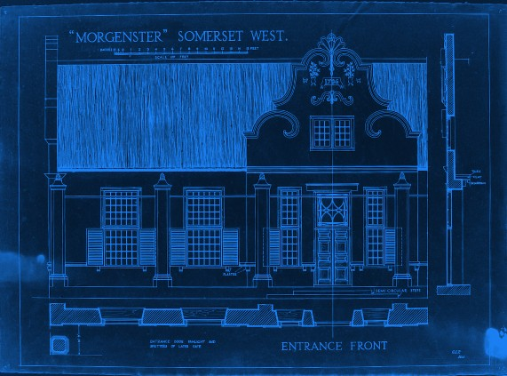
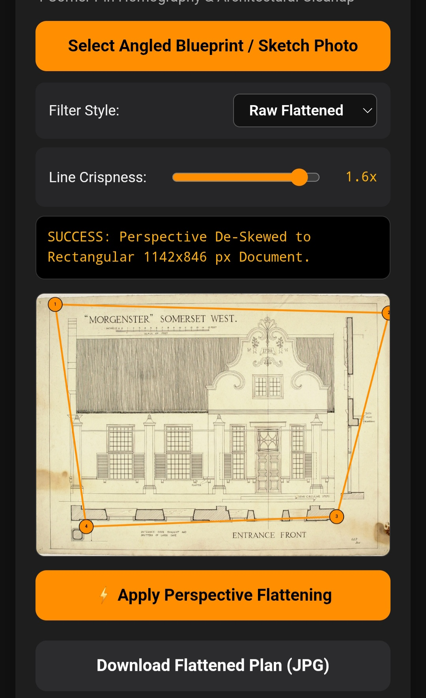
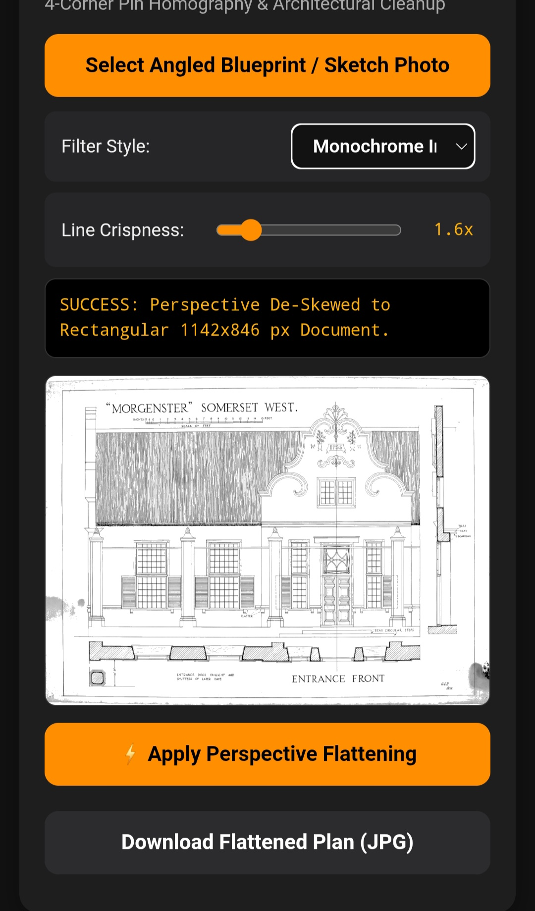

# Spatial & Architectural Processing Suite

**Production Web Suite:** [https://satsujjinn.github.io/spatial-architectural-suite/](https://satsujjinn.github.io/spatial-architectural-suite/)

A client-side, zero-dependency HTML5 Canvas toolkit engineered for historical aerial photogrammetry, projective homography rectification, bicubic super-sampling, and architectural scale model fabrication.

## Technical Demonstrations

### Projective Rectification Output ("Morgenster" Somerset West Elevation)

### Perspective De-Skew Interface
| 4-Point Homography Control | Monochrome Thresholding |
| :---: | :---: |
|  |  |

## Core Modules

| Module | File | Mathematical Implementation |
| :--- | :--- | :--- |
| **Perspective De-Skew** | `000_Architectural_Perspective_App.html` | 8-DOF projective homography solved via `Float64Array` Gaussian elimination with partial pivoting and bilinear interpolation. |
| **Scale Model Calculator** | `000_Architectural_Scale_Model_App.html` | Bidirectional metric-to-scale conversion, material thickness butt-joint deduction, secant roof pitch projection, and 2-point photogrammetric calibration. |
| **Ortho-Rectifier & Upscaler** | `000_Aerial_Super_Upscaler_App.html` | Optical scale derivation ($H = f \cdot S$) from 228.6 mm survey negatives and inclinometer centroid homography transformation. |
| **Universal Resampler** | `000_Universal_Photo_Upscaler_App.html` | Single-pass dynamic range normalization, gain scaling, and 5-point Laplacian unsharp masking with boundary preservation. |
| **Mosaic Stitcher V3** | `000_Aerial_Mosaic_Stitcher_App_V3.html` | Zero-Mean Normalized Cross-Correlation (ZNCC) and L1 minimum-difference block matching with radial alpha feathering. |

## System Architecture & Constraints
* **Execution Environment:** Client-side ECMAScript / HTML5 2D Context (`willReadFrequently: true`).
* **Memory Management:** Enforces a strict $16,777,216$ pixel ($4096 \times 4096$) allocation ceiling to maintain stability on mobile WebKit/Blink engines.
* **Data Privacy:** Zero network transmission; all raster buffers are processed locally in volatile memory.

## License
MIT License. Copyright (c) 2026 Leon Christoffel Mynhardt Jordaan. See `LICENSE` for full terms.
