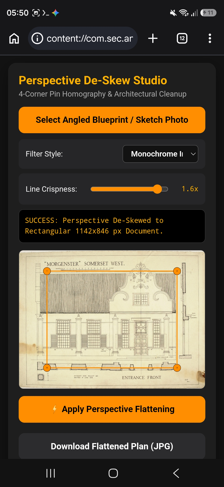
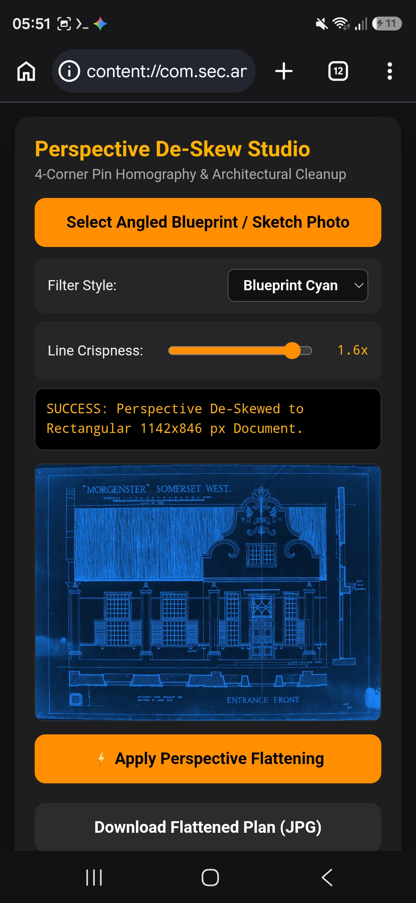
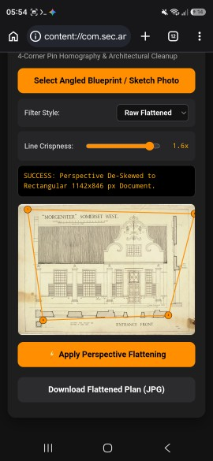

# Spatial & Architectural Processing Suite

An open-source collection of specialized, web-based tools for historical aerial photogrammetry, image super-sampling, and architectural document perspective correction.

## 📸 Demo Gallery

### Architectural Perspective De-Skew Studio
| Interactive Corner Pins | Blueprint Cyan Filter | Raw Flattened Mode |
| :---: | :---: | :---: |
|  |  |  |

### Output Result ("Morgenster" Somerset West Architectural Plan)

## Applications
1. **Aerial Super-Upscaler & Rectifier**: Calculates flight parameters and applies inclinometer homography to historical survey plates.
2. **Universal Photo Upscaler**: Multi-pass resolution booster with unsharp edge recovery and level balancing.
3. **Architectural Perspective De-Skew Studio**: Four-point corner pin warping to flatten angled blueprint and sketch photos[span_0](start_span)[span_0](end_span)[span_1](start_span)[span_1](end_span)[span_2](start_span)[span_2](end_span)[span_3](start_span)[span_3](end_span)[span_4](start_span)[span_4](end_span)[span_5](start_span)[span_5](end_span).
4. **Mosaic Stitcher V3**: Strip alignment preserving metadata tags and flight instruments.

## License
Distributed under the MIT License. See `LICENSE` for details.
